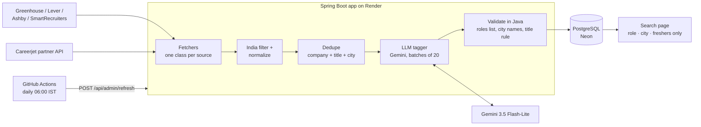

# Fresher Jobs India

A small job portal for Indian college students and freshers. Every day it collects internship and entry-level jobs from public sources, removes duplicates, uses an LLM to tag each post by **role**, **city** and **fresher-friendly**, and shows them on a searchable page.

**Live:** https://beep-jobs.onrender.com  (free tier: the first visit after a quiet period can take ~1 minute to wake up)

| | |
|---|---|
| Jobs collected | 2,800+ from 5 sources (63 company job boards + Careerjet) |
| Fresher-friendly (AI tag) | ~870 |
| Refresh | Daily at 06:00 IST via GitHub Actions |
| Special feature | **Ask AI**: search in plain English; the AI sets filters, never invents jobs |
| Tagging accuracy (50 posts hand-checked) | role 76% · city 98% · fresher 96% |
| LLM cost | ≈ $0.16 per 1,000 posts at paid rates (runs on the free tier) |
| Hosting cost | ₹0 (Render, Neon, GitHub Actions free tiers) |

---

## How it works



1. **Fetch**: one `JobFetcher` class per source. A failing company board is skipped; the rest of the run continues. Max 200 jobs per company.
2. **Keep India only**: whole-word match on Indian city names and "India" (`cities.txt`), so "Indianapolis" is not India.
3. **Dedupe**: key = normalized `company | title | city` (lowercase, no "Pvt Ltd/Inc", Bangalore → Bengaluru), with a unique constraint in the database. Same source + same id = already stored; same key from another source = duplicate.
4. **Tag**: only new posts go to the LLM, 20 per call, title + company + location + first 2,000 characters of the description.
5. **Validate**: role must be in a fixed list of 20 (else "Other"), city names normalized, and a clear junior/senior word in the title overrides the model's fresher answer. A batch that fails twice falls back to rule-based tags, so nothing stays untagged.
6. **Log**: every run writes one `run_log` row: fetched, new, duplicates, tagged, input/output tokens, cost. The cost numbers below come from these rows.

## Sources (and why they are allowed)

No scraping. LinkedIn, Naukri, Indeed, Internshala and Glassdoor forbid it, so they are not used.

| Source | Access | Why it is allowed |
|---|---|---|
| Greenhouse, Lever, Ashby, SmartRecruiters | Public job-board APIs, no key | Companies publish these boards so their openings can be shown anywhere |
| Careerjet | Free partner API key | Official partner program; results link back through Careerjet and the page shows "Jobs by Careerjet" |

Company boards have plenty of India jobs but mostly for experienced people. Careerjet (keyword search: fresher, internship, trainee, 0-1 years…) supplies most of the fresher posts.

## LLM tagging

- **Model:** `gemini-3.5-flash-lite` through Gemini's OpenAI-compatible API, called with **Spring AI** (`ChatModel`), JSON mode, temperature 0. The model is a config value (`LLM_MODEL`).
- **Prompt:** [`src/main/resources/prompts/tagging-system.txt`](src/main/resources/prompts/tagging-system.txt) (v3). Earlier versions are kept next to it.
- **Retries:** 429/503 responses are retried with exponential backoff (5 s → 60 s).

### Accuracy

50 random tagged posts (fixed seed, so the same 50 can be re-checked) were labelled by hand without looking at the AI's tags, then compared.

| Prompt | Role | City | Fresher | All three right | Cost / 1,000 posts |
|---|---|---|---|---|---|
| v1 | 76% | 98% | 84% | 64% | $0.13 |
| v2 | 70% | 96% | 96% | 62% | (not measured at scale) |
| **v3 (live)** | **76%** | **98%** | **96%** | **70%** | **$0.16** |

Cost per 1,000 is measured over the full re-tag of all 2,682 live posts with each prompt.

What changed:
- **v1 → v2:** in all 8 fresher misses the model had no experience information. Long posts were cut at 800 characters before the "X years" line, and SmartRecruiters' "Experience level" field is often wrong ("Senior Full Stack Developer" marked "Associate"). Fix: a Java rule where the title beats everything else ([`TitleSignals`](src/main/java/com/beep/jobportal/tag/TitleSignals.java), unit-tested), a prompt that says so, and 2,000 characters instead of 800. v2 also added one-line role definitions.
- **v2 → v3:** the role definitions disagreed with the hand labels on fuzzy categories (collections, architects), so role accuracy dropped. v3 removes them and keeps the fresher fixes.

Caveat: v2 and v3 were tuned and tested on the same 50 posts, so the improvement may be slightly optimistic. Most remaining role misses are genuinely ambiguous (Marketing vs Content, collections roles, architects); the role list has no Data Engineering or IT Support category, which is the obvious next change.

### Cost

```
cost = input tokens × $0.30 / 1M  +  output tokens × $2.50 / 1M      (Gemini 3.5 Flash-Lite, paid tier)
```
Prices from Google's pricing page (checked 16 Nov 2026). Token counts are the real `usage` numbers returned by the API and stored in `run_log`. Measured over all 2,682 live posts, v3 uses ~254 input and ~33 output tokens per post ≈ **$0.16 per 1,000 posts** (v1: ~144 in / 36 out ≈ $0.13; v3 sends 2,000 description characters instead of 800). A normal daily run tags 100–700 new posts, i.e. a few cents. The project runs on Gemini's free tier, so the actual spend is $0.

## Daily refresh

Render's free web service sleeps when idle, so an in-app `@Scheduled` job would not fire. Instead [`.github/workflows/daily-refresh.yml`](.github/workflows/daily-refresh.yml) runs at 06:00 IST: wakes the app, calls `POST /api/admin/refresh` with a secret token, then polls `/api/runs/latest` every minute until the run finishes (which also keeps the app awake). Can also be started from the Actions tab.

## Ask AI search

Type what you want in your own words, e.g. *"data analyst internship in Bangalore"*. Gemini turns the sentence into filters (keywords, role, city, freshers) and fills in the normal search controls, so you can see what it understood. The jobs come from the normal search, so the AI can't make up a job.

- **The AI only sets filters.** The prompt ([`ask-system.txt`](src/main/resources/prompts/ask-system.txt)) asks for one JSON object. Java keeps only roles from the fixed list and known city names ([`AskService`](src/main/java/com/beep/jobportal/ask/AskService.java)).
- **Java writes the reply**, e.g. "Found 4 fresher Data Analyst jobs in Bengaluru."
- **When nothing matches**, it suggests close searches that do have jobs ("All cities", "Without 'kotlin'"). For places outside India it says the portal only lists jobs in India.
- **Off-topic or prompt-injection text** ("hello", "ignore all instructions…") gets "I can only help you find jobs."
- **If Gemini is slow or busy** (over 12 s, or a 503), simple word-matching rules answer instead, and the page says so.
- **Limits:** 6 asks a minute per IP and 20 AI calls a minute overall, so the free Gemini quota stays available for the daily tagging run.

## Web page and security

- **Page:** one plain HTML/JS file served by Spring Boot. Search, role and city filters, a "Freshers only" switch, page numbers, an Apply button on every job, a loading state, and a clear message when a request fails. Works on phones and follows the system light/dark theme.
- **Rate limit:** per IP, 60 requests a minute on `/api/*`, 10 a minute on `/api/admin/*` and 6 a minute on `/api/ask`; over the limit the API answers `429` with `Retry-After` ([`RateLimitFilter`](src/main/java/com/beep/jobportal/web/RateLimitFilter.java)). In memory, which is fine for one Render instance.
- **Security headers** on every response: `X-Frame-Options: DENY`, `X-Content-Type-Options: nosniff` and a `Content-Security-Policy` that only allows the site's own content ([`SecurityHeadersFilter`](src/main/java/com/beep/jobportal/web/SecurityHeadersFilter.java)).
- **Testing:** unit tests for search, title rule, city list, Ask AI (with a faked Gemini and database), rate limit and headers (`mvn test`), plus an 89-case manual test sheet run against the live site.

## Tech stack

Java 17 · Spring Boot 3.5 · Spring AI 1.1 · PostgreSQL (Neon) · Flyway · Jsoup · plain HTML/JS front end served by Spring Boot · Docker · Render · GitHub Actions

**Why Java and no separate Python service:** the AI part is one API call per batch, which Spring AI handles well. A second backend would mean a second deployment and more things to break.

## Run it locally

Requires JDK 17, Maven and Docker.

```bash
docker compose up -d          # Postgres on localhost:5433
cp .env.example .env          # then fill in the keys
mvn spring-boot:run           # http://localhost:8080
```

Trigger a refresh (needs `ADMIN_TOKEN` set in `.env`):
```bash
curl -X POST -H "X-Admin-Token: $ADMIN_TOKEN" "http://localhost:8080/api/admin/refresh?wait=true"
```

### Environment variables

| Variable | Purpose |
|---|---|
| `DB_URL`, `DB_USER`, `DB_PASSWORD` | PostgreSQL (defaults to the local Docker DB) |
| `ADMIN_TOKEN` | Secret for the `/api/admin/*` endpoints |
| `LLM_API_KEY`, `LLM_BASE_URL`, `LLM_COMPLETIONS_PATH`, `LLM_MODEL` | Any OpenAI-compatible LLM (Gemini settings in `render.yaml`) |
| `CAREERJET_API_KEY` | Careerjet partner key (source is skipped if empty) |

### API

| Endpoint | Auth | Purpose |
|---|---|---|
| `GET /api/jobs?q=&role=&city=&fresher=&page=` | public | Search |
| `GET /api/filters` | public | Roles and cities with counts |
| `GET /api/stats` | public | Totals and last update time |
| `GET /api/ask?q=` | public (6/min per IP) | Ask AI: sentence → filters + reply |
| `GET /api/runs/latest` | public | Latest run summary |
| `POST /api/admin/refresh` | token | Fetch + dedupe + tag |
| `POST /api/admin/tag` | token | Tag untagged jobs only |
| `POST /api/admin/retag?ids=` | token | Re-tag given jobs with the current prompt |
| `GET /api/admin/sample?size=&seed=` | token | Random sample without tags, for hand-labelling |

## Project layout

```
src/main/java/com/beep/jobportal/
  fetch/       one fetcher per source + shared HTTP client
  normalize/   India filter, city aliases, dedupe key
  tag/         LLM call, validation, title rule
  run/         refresh pipeline, run_log, admin endpoints
  job/         entity, repository, public API
src/main/resources/
  sources.yml        company boards per source (add a company = one line)
  tagging.yml        role list, batch size, prices
  cities.txt         Indian city names and aliases
  prompts/           tagging prompt v1, v2, v3
  db/migration/      Flyway SQL
```

## Known limitations / next steps

- Closed jobs are not removed yet (next: mark jobs missing from the source for N days as expired).
- A few Careerjet duplicates get through when the same job is posted with different location text (for example "Bangalore, Karnataka, India" and "Karnataka, India"); 3 found in 2,874.
- The rate limit reads the client IP from the first `X-Forwarded-For` entry (Render is behind a proxy). A client can fake that header to get around the limit; it cannot use it to reach anything else.
- Careerjet only accepts requests from declared IPs; if Render's outgoing IP changes, it has to be re-declared (`GET /api/admin/egress-ip` shows it).
- Role list could add Data Engineering and IT Support; re-measure on a fresh sample of 50.
- Search matches whole words loosely ("intern" also matches "international"), so Ask AI drops "intern" and uses the fresher filter instead.
- Problems hit while building and how they were fixed: [WHAT_BROKE.md](WHAT_BROKE.md).
